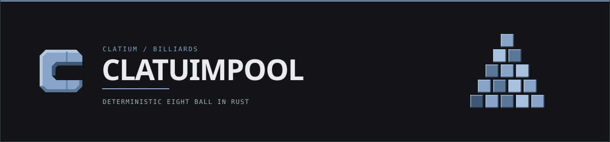
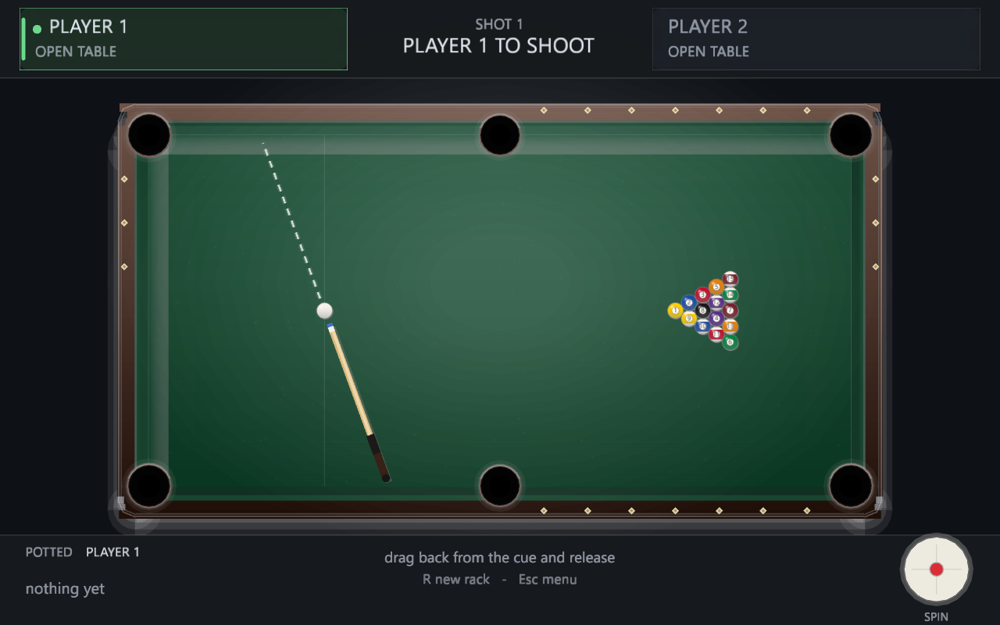
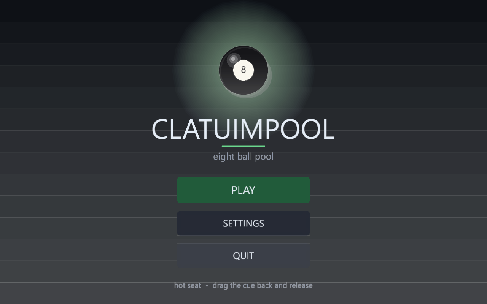
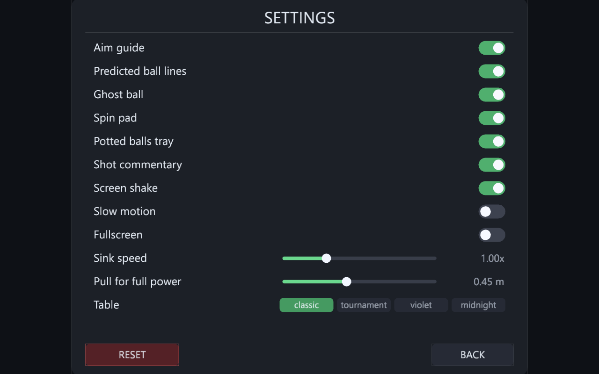

<div align="center">
  
</div>

<br>

<div align="center">
  <a href="https://github.com/contactjayclatty/CLATUIMPOOL/releases/latest"></a>
  <a href="crates/pool-core/src/lib.rs"></a>
  <a href="Cargo.toml"></a>
  <a href="https://github.com/contactjayclatty/CLATUIMPOOL/releases/latest"></a>
  <a href="LICENSE-MIT"></a>
</div>

<br>

> **Sixteen balls, two players, one stubborn eight ball.**
> Everything between the cue tip and the pocket is a deterministic Rust simulation — the same
> shot always ends in the same place, down to the millimetre.

<br>

<sub><code>01 — THE TABLE</code></sub>

## Look at it

<div align="center">
  
</div>

<div align="center">
  
  
</div>

<br>

<sub><code>02 — WHAT YOU GET</code></sub>

## On the table

| | |
|:--|:--|
| **REGULATION GEOMETRY** | 2.54 m × 1.27 m playing surface, six pockets, 57.15 mm balls, and the standard rack — 1 on the foot spot, 8 dead centre, a solid and a stripe in the back corners. |
| **TRUE COLOURS** | White cue ball, yellow 1 through maroon 7, black 8, and 9–15 as striped versions of 1–7, each with a shaded sphere, specular highlight and legible number disc. |
| **CUE BALL SPIN** | Follow drags the cue through contact, draw pulls it back, side spin throws the object ball off the line of centres and kicks it off the cushions. |
| **SINKING** | A potted ball slides the last centimetres into the pocket, shrinks behind the rim, fades, and ripples the cloth. |
| **POTTED TRAY** | The balls each player has sunk stay visible in the bottom bar, and the tray swaps over the moment the turn does. |
| **AIMING AIDS** | Dashed cue path, ghost ball at the contact point, the object ball's projected line and the cue ball's deflection — every layer can be switched off. |
| **BALL IN HAND** | A ghost cue ball follows the cursor: green where it may be placed, red against a ball, a cushion or a pocket mouth. |
| **SIXTEEN SETTINGS** | Aim guide, ball lines, ghost ball, spin pad, tray, commentary, FPS, shake, slow motion, fullscreen, sink speed, pull distance, four table finishes — all saved to `clatuimpool.cfg`. |

<br>

<sub><code>03 — HOW TO PLAY</code></sub>

## Controls

| Input | Action |
|:--|:--|
| **Move mouse** | Aim — the cue sits between the cursor and the cue ball |
| **Hold left button, drag away** | Pull the cue back; further is harder |
| **Release** | Shoot |
| **Drag inside the spin pad** | Follow / draw up and down, side spin left and right |
| **Left click** | Place the cue ball when the banner says BALL IN HAND |
| <kbd>R</kbd> | New rack |
| <kbd>Esc</kbd> | Pause menu |
| <kbd>Enter</kbd> | Play again on the game over screen |

<br>

<sub><code>04 — THE MODEL</code></sub>

## Physics that behaves

| | |
|:--|:--|
| **CONTINUOUS COLLISION** | Swept time-of-impact for ball–ball and ball–cushion, so a 6.5 m/s break cannot tunnel through the pack. |
| **FIXED STEP** | 240 Hz sub-steps with at most 64 impacts per step, then a four-pass overlap clean-up so nothing renders inside anything else. |
| **CLOTH** | 0.6 m/s² rolling deceleration — a lag shot crosses the full table and comes back. |
| **CUSHIONS** | 0.86 restitution, a little tangential grip, and mouths cut out of the rails so a ball drops when its centre enters the drawn hole — never from open felt. |
| **CONTAINMENT** | Every step clamps the active balls inside the cushion line, so a squeezed ball is slid back onto the cloth instead of resting on a rail. |
| **SPIN** | Follow and draw are applied as a post-contact velocity transfer, side spin as a throw on the object ball and a kick off the cushion. |
| **DETERMINISM** | The same input reproduces the same final positions exactly — asserted by the test suite, not by hope. |

## Rules that hold up

Open table, group assignment from the first legal pot, turn passing, and fouls for potting
the cue ball, hitting nothing, hitting the wrong group first, hitting the 8 first, or failing
to reach a cushion. Fouls hand over ball in hand. The 8 is re-spotted if it drops on the
break, loses the frame if it drops early, and wins it when the shooter's group is already
clear.

<br>

<sub><code>05 — BUILD</code></sub>

## Build from source

```bash
cargo run --release
```

A Rust toolchain with edition 2024 support (1.85+) is all that is needed; the first build
pulls [`macroquad`](https://macroquad.rs) and takes a couple of minutes. The Windows build is
GUI-only — no console window, launched from a terminal, a shortcut or Explorer alike. While
debugging, `cargo run --features console` brings the terminal back.

Prefer a binary? Grab `clatuimpool-v<version>-win64.zip` from the
[releases page](https://github.com/contactjayclatty/CLATUIMPOOL/releases/latest): a single
self-contained executable for 64-bit Windows 10 or newer.

```bash
cargo test -p pool-core                              # 14 simulation and rules tests
cargo clippy --workspace --all-targets -- -D warnings
cargo fmt --all --check
```

<br>

<sub><code>06 — INSIDE</code></sub>

## Two crates, one boundary

```
CLATUIMPOOL
├─ crates/pool-core      physics, table, rack, rules — zero dependencies, zero graphics
│  ├─ vec2.rs            the only maths type the simulation needs
│  ├─ physics.rs         time-of-impact solver, impulses, friction, spin, containment
│  ├─ rules.rs           open table, groups, fouls, eight-ball outcomes
│  └─ game.rs            fixed-step driver, events, pockets, ball in hand
└─ crates/clatuimpool    window, screens, input, drawing (macroquad 0.4)
   ├─ render.rs          table, balls, pockets, aim lines, themes
   ├─ ui.rs              buttons, toggles, sliders, segmented pickers
   └─ settings.rs        persisted settings
```

The core knows nothing about pixels, so the whole game can be tested headlessly and the
renderer can only ever be a view of it.

<br>

<sub><code>07 — SHIP</code></sub>

## Releasing

The version lives in one place — `version` under `[workspace.package]` in the root
`Cargo.toml`.

```powershell
pwsh -File scripts/package.ps1
```

builds `target\release\clatuimpool.exe` and zips it with the README and both licences into
`dist\clatuimpool-v<version>-win64.zip`. Pushing a `v*` tag runs
`.github/workflows/release.yml`, which formats, lints, tests, packages and publishes the
release on `windows-latest`.

```bash
git tag v0.1.0
git push origin v0.1.0
```

<br>

<sub><code>08 — LICENCE</code></sub>

## MIT OR Apache-2.0

Pick either, at your option. See [`LICENSE-MIT`](LICENSE-MIT) and
[`LICENSE-APACHE`](LICENSE-APACHE).

<br>

<div align="center">
  <sub><code>CLATIUM · CLATUIMPOOL v0.1.0 · RUST + MACROQUAD · MIT OR APACHE-2.0</code></sub>
</div>
